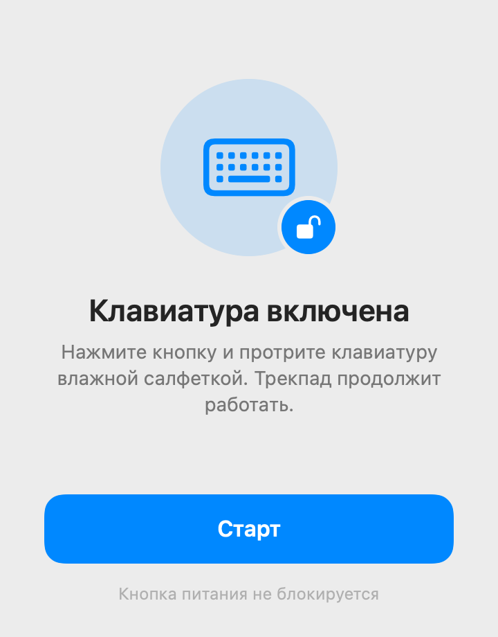
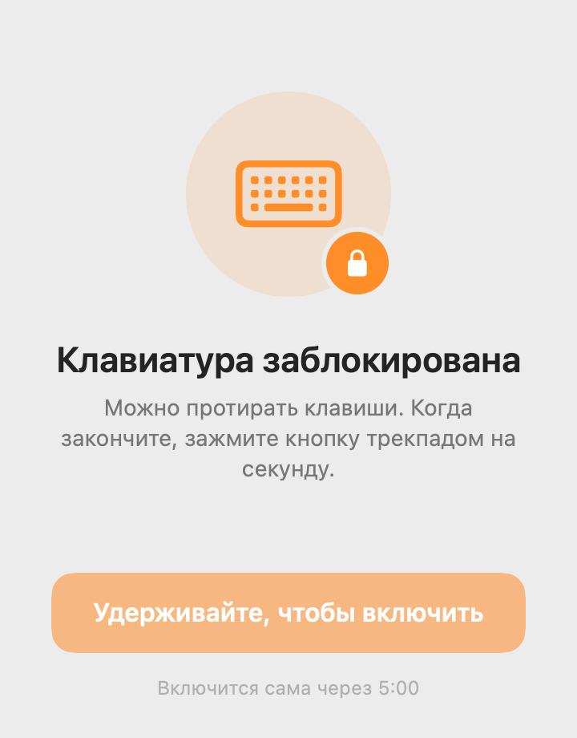

# KeyClean: блокировка клавиатуры Mac на время протирки

Нажимаете «Старт» и протираете клавиатуру влажной салфеткой. Нажатия никуда не уходят: ни буквы, ни сочетания клавиш, ни яркость с громкостью, ни Caps Lock. Трекпад и мышь продолжают работать. Когда закончите, зажмите кнопку трекпадом на секунду, и клавиатура снова заработает.

<p>
  
  
</p>

## Скачать

[KeyClean 1.0 для macOS](https://github.com/dimyan-l/KeyClean/releases/tag/v1.0)

Откройте `KeyClean.dmg` и перетащите `KeyClean.app` в «Программы». Нужна macOS 14 или новее, сборка Universal для Apple Silicon и Intel. Приложение подписано локальным сертификатом и не нотаризовано Apple. Если macOS не даёт его открыть, зайдите в «Системные настройки → Конфиденциальность и безопасность» и нажмите «Всё равно открыть». Затем выдайте «Универсальный доступ», как описано в [установке](#установка). Собрать программу из исходников можно по той же инструкции.

## Что учтено

- **Разблокировка только удержанием.** После «Старт» курсор остаётся на кнопке, и тряпка легко «тапнет» по трекпаду. Короткое касание клавиатуру не включает.
- **Блокировка экрана или сон.** Если задеть кнопку питания с Touch ID, Mac уснёт или сменится пользователь, клавиатура сразу возвращается: иначе пароль на экране входа было бы нечем ввести.
- **Страховочный таймер.** Через 5 минут клавиатура включится сама, даже если трекпад не сработал.
- **Экран не гаснет** и заставка не включается, пока клавиатура заблокирована.
- **Caps Lock** macOS переключает раньше, чем нажатие можно перехватить. Поэтому на время блокировки он переназначается на F20 через `hidutil`, а потом назначение снимается, даже если программу закрыли через `kill`. Если в Настройках у клавиатур заданы свои назначения клавиш, Caps Lock не трогается, чтобы их не сломать.
- **Защищённый ввод.** Если другая программа включила Secure Input (например, поле пароля), macOS не отдаёт ей нажатия, и KeyClean честно об этом предупреждает.
- **Поверх всех окон.** Пока клавиатура заблокирована, окно видно на всех рабочих столах и поверх полноэкранных программ.

Кнопка питания не блокируется: её обрабатывает сама система.

## Установка

Нужна macOS 14 или новее и инструменты разработчика (полный Xcode не нужен):

```bash
xcode-select --install
```

Соберите и установите программу:

```bash
git clone https://github.com/dimyan-l/KeyClean.git
cd KeyClean
./build_app.sh --install
```

При первом запуске нажмите «Дать разрешение» и включите KeyClean в «Системные настройки → Конфиденциальность и безопасность → Универсальный доступ». Это нужно один раз: без разрешения macOS не даёт перехватывать клавиатуру.

Другие варианты сборки:

| Команда | Что делает |
|---|---|
| `./build_app.sh` | собирает `build/KeyClean.app` |
| `./build_app.sh --install` | ставит в «Программы» и запускает |
| `./build_app.sh --dmg` | собирает образ `build/KeyClean.dmg` |

Без своего сертификата подписи программа подписывается ad-hoc, и после пересборки macOS может попросить выдать разрешение заново. Чтобы этого не было, создайте в «Связке ключей» сертификат для подписи кода и передайте его имя при сборке: `SIGN_IDENTITY="Имя сертификата" ./build_app.sh --install`.

## Проверка

```bash
/Applications/KeyClean.app/Contents/MacOS/KeyClean --selftest
```

Самопроверка нажимает F20 (на клавиатурах Mac её нет) и убеждается, что без блокировки клавиша проходит, с блокировкой не проходит, а после выключения всё возвращается как было, включая назначения клавиш. Перед запуском снимите блокировку в самом KeyClean, иначе два перехвата наложатся друг на друга.

## Как устроено

- `KeyboardBlocker.swift`: перехват событий клавиатуры на уровне HID (`CGEvent.tapCreate`) и их выброс. Если macOS отключит перехват по таймауту, он включается снова.
- `CapsLockGuard.swift`: временное переназначение Caps Lock через `hidutil`.
- `AppModel.swift`: состояние, таймер, реакция на сон и блокировку экрана.
- `ContentView.swift`: окно на SwiftUI.

## Лицензия

[MIT](LICENSE)
